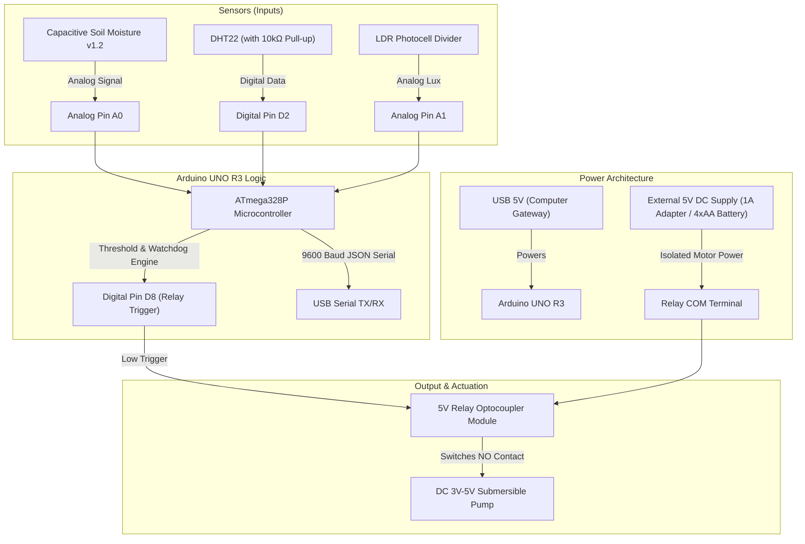

# ⚡ FARMATRIX Hardware Circuit Diagram & Wiring Guide
### Smart IoT Agriculture Monitoring & Automated Micro-Irrigation Engine
*Target Microcontroller: Arduino UNO R3 (ATmega328P) • Optical Relay Isolation • Soil & Climate Sensing*

---

## 📌 1. High-Level Hardware Architecture

The FARMATRIX physical layer connects an **Arduino UNO R3** to field-level sensing and actuation hardware:
1. **Soil Sensing**: Capacitive Soil Moisture Sensor v1.2 (Corrosion-resistant analog output on Pin `A0`).
2. **Climate Sensing**: DHT22 / AM2302 High-Precision Digital Temperature & Relative Humidity sensor on Pin `D2`.
3. **Automated Irrigation**: 5V Active-Low Optocoupler Relay Module on Pin `D8` switching a submersible 3V–5V DC mini-pump.
4. **Light Sensing (Optional)**: LDR divider circuit on Pin `A1`.
5. **Gateway Bridge**: USB Serial output at `9600` baud delivering real-time canonical JSON telemetry packets to the Node.js gateway or Web Serial API.



---

## 🔌 2. Complete Pin-to-Pin Connection Table

| Component | Component Pin | Arduino UNO R3 Pin | Wire Color Recommendation | Notes |
| :--- | :--- | :--- | :--- | :--- |
| **Capacitive Moisture Sensor** | **VCC** | **5V** | 🔴 Red | 3.3V or 5V compatible (5V gives broader ADC range) |
| | **GND** | **GND** | ⚫ Black | Shared Arduino Ground |
| | **AOUT / SIG** | **A0** | 🟢 Green | Analog reading (ADC 310 submerged – 720 dry air) |
| **DHT22 (AM2302)** | **Pin 1 (VCC)** | **5V** | 🔴 Red | Sensor power supply |
| | **Pin 2 (DATA)** | **Digital 2 (D2)** | 🔵 Blue | Single-bus digital bidirectional line |
| | **Pin 3 (NC)** | *Not Connected* | — | Unused on bare DHT22 |
| | **Pin 4 (GND)** | **GND** | ⚫ Black | Shared Arduino Ground |
| | *Pull-up Resistor* | *Across Pin 1 & 2* | 🟡 10kΩ Resistor | **10 kΩ resistor between VCC (Pin 1) & DATA (Pin 2)** |
| **5V Single-Channel Relay** | **VCC** | **5V** | 🔴 Red | Low-voltage logic coil power |
| | **GND** | **GND** | ⚫ Black | Low-voltage logic ground |
| | **IN** | **Digital 8 (D8)** | 🟠 Orange | Active-Low digital control trigger |
| | **NO (Normally Open)** | **Pump Positive (+)**| 🟣 Pink / Red | External circuit to mini-pump |
| | **COM (Common)** | **External 5V (+)** | 🟣 Pink / Red | Connected to external 5V power supply |
| **DC Mini Pump (Submersible)**| **V+ (Red wire)** | **Relay NO** | 🟣 Pink / Red | Switched via relay contact |
| | **GND (Black wire)**| **External 5V (-)** | ⚫ Black | Return path to external power supply |

---

## 🎨 3. Visual Circuit Schematic (ASCII)

```
       +---------------------------------------------------------------+
       |                      ARDUINO UNO R3                           |
       |                                                               |
       |   [USB Port] ===> To Mac/PC Gateway (9600 Baud)               |
       |                                                               |
       |   [Digital Pins]                               [Power / Analog]|
       |    D2  --------------------+                    5V  ---+-----+ |
       |    D8  ---------------+    |                    GND ---|--+--+ |
       +----+------------------+----+--------------------+------+--+--+-+
            |                  |    |                           |  |  |
            |                  |    |      +--------------------+  |  |
            |                  |    |      |    +------------------+  |
            |                  |    |      |    |                     |
            |                  |    |      |    |                     |
     [Orange Wire]             | [Blue]    |    |                     |
            |                  |    |      |    |                     |
            v                  |    |      v    v                     |
    +---------------+          |    |   +--------------+              |
    | 5V RELAY MOD  |          |    |   | DHT22 SENSOR |              |
    |               |          |    |   |              |              |
    | IN  <---------+          |    +-> | DATA (Pin 2) |              |
    | VCC <--------------------+        | VCC  (Pin 1) <----+         |
    | GND <-----------------------------+ GND  (Pin 4) <----+         |
    |               |                       |       ^       |         |
    |  HIGH VOLTAGE |                       +-[10kΩ]-+       |         |
    |  TERMINALS    |                       (Pull-up Resistor)        |
    |               |                                                 |
    |  COM     NO   |                   +-----------------------------+
    +---+-------+---+                   |   +-------------------------+
        |       |                       |   |   +---------------------+
        |       |                       v   v   v
        |       |                    +---------------+
        |       |                    | CAPACITIVE    |
        |       |                    | SOIL MOISTURE |
        |       |                    |               |
        |       |                    | VCC <---------+
        |       |                    | GND <---------+
        |       |                    | AOUT ---------> To Arduino A0
        |       |                    +---------------+
        |       |
        |       +----------------------------+
        |                                    |
        |                                    v
+-------+--------------------+      +--------------------+
| EXTERNAL 5V POWER SUPPLY   |      | DC MINI PUMP       |
| (Battery Pack or Adapter)  |      | (Submersible)      |
|                            |      |                    |
| (+) Positive 5V Output     |      | (+) Wire (Red) <---+
| (-) Ground Return (GND) ---+----->| (-) Wire (Black)   |
+----------------------------+      +--------------------+
```

---

## 🛡️ 4. Electrical Safety & Engineering Safeguards

### 1. Galvanic Power Isolation for the Pump Motor
> [!CAUTION]
> **Never power the DC mini pump directly from the Arduino 5V pin!**
> Inductive kickback and motor inrush current will cause the Arduino microcontroller to brown out, reboot continuously, or burn out the onboard voltage regulator.

* The pump must be powered by a dedicated **external 5V / 1A power supply** (or 4xAA battery pack).
* The 5V relay module provides **galvanic optocoupler isolation**, separating the microcontroller's sensitive digital logic from high-current motor transients.

### 2. Active-Low Relay Logic
Standard 5V Arduino relay modules are **Active-Low**:
* `digitalWrite(RELAY_PIN, LOW)` &rarr; Relay energizes, NO closes, **Pump turns ON**.
* `digitalWrite(RELAY_PIN, HIGH)` &rarr; Relay de-energizes, NO opens, **Pump turns OFF**.
* In `setup()`, initialize `pinMode(RELAY_PIN, OUTPUT)` and immediately write `digitalWrite(RELAY_PIN, HIGH)` to prevent unintended pump firing during boot.

### 3. Firmware Watchdog & Safeguards
* **Maximum Continuous Runtime**: Hardcoded limit of 180 seconds. If soil moisture doesn't reach the cutoff point within 180 seconds, the relay automatically disconnects to prevent reservoir depletion or flooded pots.
* **Thermal Cooldown**: Enforces a minimum 300-second rest period after any pump run to allow water absorption into the root zone before re-evaluating moisture.

### 4. Capacitive vs. Resistive Soil Probes
* FARMATRIX specifies **Capacitive v1.2** sensors. Unlike older resistive probes with exposed copper traces, capacitive sensors have a solder-mask conformal coating and measure dielectric permittivity without conducting current through the soil, preventing electrolysis corrosion.

---

## 📐 5. Sensor Calibration Instructions

1. **Air Calibration (Dry Reading)**:
   * Hold the capacitive probe in dry ambient air.
   * Open the Arduino Serial Monitor at 9600 baud.
   * Note the raw ADC value: typically **`~720` to `~780`**.
2. **Water Calibration (100% Saturation)**:
   * Submerge the probe blade into a cup of tap water up to the marked white line (do not submerge the electronics on the top!).
   * Note the raw ADC value: typically **`~300` to `~340`**.
3. **Map Formula in Firmware**:
   ```cpp
   float soilPct = map(rawSoil, SOIL_DRY_ADC, SOIL_WET_ADC, 0, 100);
   soilPct = constrain(soilPct, 0.0, 100.0);
   ```

---

## 🔍 6. Wiring Verification Checklist

- [ ] All ground lines on the low-voltage side share common ground with the Arduino.
- [ ] External pump power ground connects directly to the pump negative wire, NOT to the Arduino 5V.
- [ ] 10 kΩ pull-up resistor is installed between DHT22 VCC and DATA.
- [ ] Capacitive moisture sensor blade is inserted vertically into the root zone.
- [ ] Relay onboard LEDs illuminate: Red for coil power, Green when D8 drops LOW.
- [ ] USB cable connects Arduino UNO R3 to Mac/PC acting as the serial gateway.
